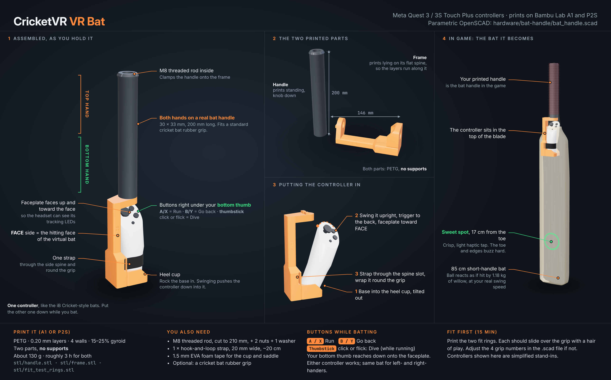

# CricketVR

WebXR cricket for Meta Quest 3 / 3S, played with a compact 3D-printed bat
attachment (iB Cricket style). Both hands go on a real bat handle, and one
controller sits at the bottom of it, under your bottom thumb.



## What's here

| Path | What it is |
| --- | --- |
| `hardware/bat-handle/` | The printable bat (handle + controller frame): OpenSCAD source, STLs, print guide. Start with its [README](hardware/bat-handle/README.md). |
| `src/bat/` | Game-side bat: turns the controller in the printed bat into a full virtual bat, plus swept ball-bat collision, impact physics, haptics and run/back/dive input. Plain three.js ES modules. |
| `src/demo/` | A nets practice scene (bowling machine) to try the bat in the headset. |
| `test/` | Unit tests for the bat rig and the physics (`npm test`). |
| `tools/` | STL/mount export (`npm run export-stl`) and the design-sheet renderer (`npm run render-design`). |

## How the bat responds like a real bat

- **The virtual bat follows the controller exactly.** The controller's
  seat in the printed frame is known (generated from the .scad file), so the
  virtual bat is locked to the real one (`src/bat/batRig.js`). A light
  filter removes jitter when you're still and adds almost no lag during a
  swing. Settings sliders fine-tune the alignment. Auto mode uses whichever
  controller is in the bat.
- **No tunnelling.** Contact is swept between frames. The bat pose is
  interpolated and the ball's flight sub-stepped, so a 40 m/s ball can't pass
  through a 30 m/s toe at 72 Hz (`src/bat/batPhysics.js`).
- **Real impact physics.** The impulse uses the bat's effective mass at the
  contact point (1.18 kg, real moments of inertia). Restitution peaks at the
  sweet spot and drops toward the toe and the splice. Friction gives spin
  and makes edges deflect. A middled shot comes off far faster than the
  same swing off the toe or the splice.
- **Feel.** The middle gives a short, crisp haptic tap. The toe and the
  splice buzz long and hard.
- **Buttons.** A/X = run, B/Y = go back, thumbstick click or flick = dive,
  all on the bat's controller (`src/bat/batInput.js`).

## Try it in the headset

```bash
npm install
npm run dev
```

Open the printed `https://<your-computer-ip>:5173` address in the Quest
browser, accept the self-signed certificate warning, and press **Enter VR**.
WebXR needs HTTPS, which is why the dev server uses one. The page also has
sliders for lining up the virtual bat with your real one: face roll, forward
tilt, and slide along the handle.

Without a headset, the same page shows a desktop preview: a scripted batter
plays a drive at each ball through the full pipeline.

## Use the bat in your own scene

```js
import { BatRig } from './src/bat/batRig.js';
import { createBatMesh } from './src/bat/batModel.js';
import { sweepBall, resolveImpact, impactHaptics } from './src/bat/batPhysics.js';

const rig = new BatRig({ controller: 'auto' }); // or 'right' / 'left'
// each XR frame: rig.update({ left: pose, right: pose }, dt)
// pose = { position, quaternion, emulatedPosition } from frame.getPose(gripSpace, refSpace)
// then sweepBall(ball, rig.prevPose, rig.pose, dt, gravity) -> resolveImpact(...)
```

See `src/demo/main.js` and `src/demo/ball.js` for the full loop.
