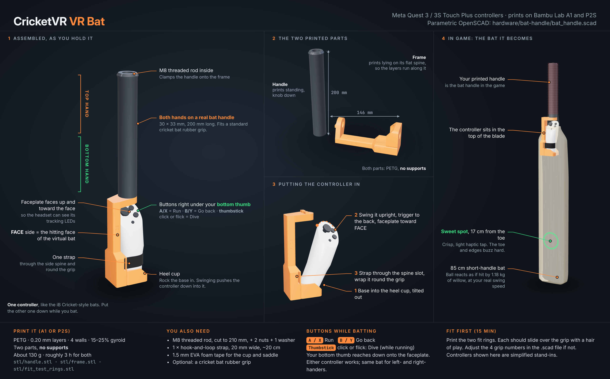

# CricketVR bat

A compact 3D-printed cricket bat attachment for one Meta Quest 3 / 3S Touch
Plus controller, in the style of the short bat handles used with iB Cricket.
You hold a real bat handle with both hands, and the controller is clamped at
the bottom of it with its buttons right under your bottom thumb.



## How it works

- **Handle:** a short, real bat handle, 30 × 33 mm oval and 200 mm long. It
  fits a standard cricket bat rubber grip.
- **One controller** sits at the bottom of the handle, in line with it,
  head up, like the start of the blade.
  - Its faceplate faces up and toward the hitting face, right under your
    bottom thumb.
  - That also keeps its tracking LEDs where the headset can see them.
  - Either controller works. Put the other one down while you bat.
- **Heel cup + strap:** the controller's base rocks into a heel cup, and one
  hook-and-loop strap through the side spine holds it upright. Swinging
  pushes it down into the cup, not out.
- **M8 threaded rod:** runs from the knob into the shoulder block and clamps
  the handle onto the frame, so the joint can't snap mid-swing.
- **Either batting hand:** it's the same bat for left- and right-handed
  batters.
- **Size:** about 35 cm long with the controller fitted, 6 cm wide.

## Files

| File | What it is |
| --- | --- |
| `bat_handle.scad` | Parametric source (OpenSCAD 2021.01+). Every size is a named parameter. |
| `stl/handle.stl` | The handle, standing on its knob, ready to print. |
| `stl/frame.stl` | The controller frame, lying on its flat spine, ready to print. |
| `stl/fit_test_rings.stl` | Two 10 mm rings to check the grip size before the full print. |
| `renders/design-sheet.png` | The design picture above. |

## 1. Check the fit first (about 15 minutes)

The controller sizes in the file are estimates. I couldn't measure a real
Touch Plus controller, so print `fit_test_rings.stl` first.

- Ring with **one notch**: the grip 15 mm above its bottom.
- Ring with **two notches**: the grip 45 mm above its bottom.

Slide each ring over the grip from the bottom, notch toward the trigger. It
should go on with a hair of play, less than 1 mm of wiggle.

If not, measure the grip with calipers at those two heights. Set these in
`bat_handle.scad`, then re-export (`npm run export-stl` from the repo root,
or OpenSCAD with `part = "frame"`):

```
grip_depth_low  = 37;  // front-to-back (trigger side to back) at 15 mm
grip_width_low  = 33;  // side-to-side at 15 mm
grip_depth_high = 40;  // front-to-back at 45 mm
grip_width_high = 35;  // side-to-side at 45 mm
head_width      = 43;  // thickness of the head, side to side
```

## 2. Print

Both parts print with no supports. The STLs are already oriented.

| Setting | Bambu Lab A1 | Bambu Lab P2S |
| --- | --- | --- |
| Filament | PETG | PETG (PETG-CF works too with a hardened nozzle) |
| Plate | Textured PEI | Textured PEI |
| Layer height | 0.20 mm | 0.20 mm |
| Wall loops | 4 | 4 |
| Infill | 15 % gyroid (handle), 25 % gyroid (frame) | same |
| Supports | Off | Off |
| Brim | 5 mm on the handle | 3 mm on the handle |

- **Handle:** 200 mm tall, stands on its knob.
- **Frame:** lies on its flat spine (146 × 53 × 58 mm as printed), so the
  layers run along the spine, which is the strongest way.
- **Material and time:** about 130 g of PETG and roughly 3 hours for both
  parts. These are estimates, so check your slicer.

## 3. What else you need

- M8 threaded rod, cut to **210 mm**, with 2 × M8 nuts and 1 × M8 washer
  (16 mm). Any hardware store has them. A dome nut on the knob end looks
  nicer.
- 1 × hook-and-loop strap, 20 mm wide (or narrower), about 20 cm long.
- 1.5 mm self-adhesive EVA foam tape.
- Optional: a cricket bat rubber grip on the handle for the real feel.

## 4. Assemble the bat

1. Press an M8 nut into the hex pocket under the shoulder block.
2. Drop the rod down through the handle from the knob end. Screw it into
   that nut, with the handle's slot sitting on the frame's tongue.
3. Put the washer and the second nut in the knob counterbore. Tighten until
   the handle can't wiggle, then stop. Don't crush the plastic.
4. Line the heel cup and the spine saddle with foam tape.
5. Thread the strap through the slot in the spine.

## 5. Put the controller in

Hold the bat so the **FACE** mark faces you.

1. Tilt the controller outward (away from the spine) and set its base in
   the heel cup.
2. Swing it upright against the spine, **trigger toward the back** (away
   from you). The faceplate now tilts toward the FACE side, under the
   handle.
3. Wrap the strap round the grip and press it closed.

To take it out, open the strap, tilt the controller outward and lift it out.

## Buttons while batting

Your bottom thumb reaches down onto the faceplate:

| Button | Action |
| --- | --- |
| A (right controller) / X (left) | Run |
| B (right controller) / Y (left) | Go back |
| Thumbstick: click, or flick it hard in any direction | Dive (only while running; ignored mid-swing) |

The trigger and grip face into the frame and aren't used.

## Safety

Clear plenty of space around you (at least 2 m) before swinging. The
controller is at the business end of the bat, so check the strap and the rod
nut before each session. The wrist lanyard can come out through the hole in
the cup floor if you want to wear it.

## Changing the design

Open `bat_handle.scad` in OpenSCAD and use the Customizer panel. Useful knobs:

- `handle_length`, `handle_width`, `handle_depth`: handle size.
- `handle_grooves = 8`: grip grooves if you won't fit a rubber grip.
- `shoulder_h`, `head_clearance`: how far below the handle the faceplate
  sits. Smaller is an easier thumb reach, but `shoulder_h` must stay at
  least 11 mm to hold the nut.
- `foam`, `clearance`: tighter or looser fit.
- `part = "assembly"`: preview with a simplified stand-in controller.

After changing sizes, run `npm run export-stl` so the game's
`src/bat/mountProfile.json` matches the printed parts.
